# evtx-triage

evtx-triage reads Windows event logs exported to JSON (JSON Lines or arrays, produced by `evtx_dump`, PowerShell `ConvertTo-Json`, Hayabusa or Chainsaw) and raises the events an analyst looks at first: cleared audit logs, RDP logons from public addresses, bursts of failed logons and a success after them, services installed with suspicious paths, additions to privileged groups, new accounts, audit policy changes, scheduled tasks, suspicious PowerShell script blocks, living-off-the-land command lines and LSASS memory access.



**Live demo:** https://jvch0512.github.io/evtx-triage/ (Synthetic data.)

D (LDC), Phobos standard library only. The demo page is rendered from the tool's `--tsv` output by `scripts/site.py` (Python 3, only needed to regenerate the page).

## Use

```bash
bin/evtx-triage examples
bin/evtx-triage ./logs --tsv
bin/evtx-triage ./logs --fail-on high       # exit 1 on any high finding
```

Exit codes: 0 ok, 1 findings at or above `--fail-on`, 2 bad input. Output is human text by default and TSV with `--tsv` (`# N files, M findings`, then `SEVERITY<TAB>RULE<TAB>WHERE<TAB>MESSAGE`).

| Rule | Severity | What it catches |
|---|---|---|
| EVT001 | critical | the Security log (1102) or System log (104) was cleared |
| EVT002 | high | an RDP logon (4624, type 10) from a public address |
| EVT003 | high | ten or more failed logons (4625) from one source address |
| EVT004 | critical | a successful logon (4624) from an address after five or more failed logons |
| EVT005 | high | a service installed (7045) with a suspicious image path |
| EVT006 | medium | a service installed (7045) |
| EVT007 | high | a member added to a privileged group (4728, 4732, 4756) |
| EVT008 | medium | a user account created (4720) |
| EVT009 | medium | the audit policy changed (4719) |
| EVT010 | medium | a scheduled task created (4698) |
| EVT011 | high | a PowerShell script block (4104) with encoded, download or credential theft keywords |
| EVT012 | high | a process creation (4688 or Sysmon 1) with a known living-off-the-land pattern |
| EVT013 | high | a Sysmon process access (10) to lsass.exe with a credential dumping access mask |
| EVT000 | info | the file holds no events |

See [examples](examples) and [docs/sample-output.txt](docs/sample-output.txt).

## Limits

- Input is JSON, not binary `.evtx`. Convert with `evtx_dump -o jsonl` or an equivalent first.
- Fields are matched by name, case-insensitively, anywhere in the record: `EventID`, `Computer`, `Channel`, `LogonType`, `IpAddress`, `TargetUserName`, `ImagePath`, `CommandLine`, `ScriptBlockText` and so on. Both the nested `Event.System` and `Event.EventData` shape and flat records work.
- The brute force and success-after-failures rules count by source address over the whole file, not inside a time window. Events are ordered by their time stamp when they have one.
- Detections are triage hints from event fields, not verdicts. Tune them for your environment before using them as alerts.

## Where it fits

Incident response triage of exported Windows logs, and quick looks at Security and Sysmon exports during a customer call.

## Tests

```bash
make test    # A D test program: every rule on crafted events, nested and flat shapes, JSON Lines and arrays, hostile input, fuzzing and CLI exit codes
```

MIT.

## Code scanning (SARIF)

`scripts/tsv2sarif.py` converts the `--tsv` output into SARIF 2.1.0, so findings show up in GitHub code scanning:

```sh
bin/evtx-triage examples --tsv | python3 scripts/tsv2sarif.py --tool evtx-triage --prefix examples > results.sarif
```

Upload `results.sarif` with `github/codeql-action/upload-sarif`. Severities map to SARIF levels (critical and high to error, medium to warning, low and info to note) and to a `security-severity` score.
